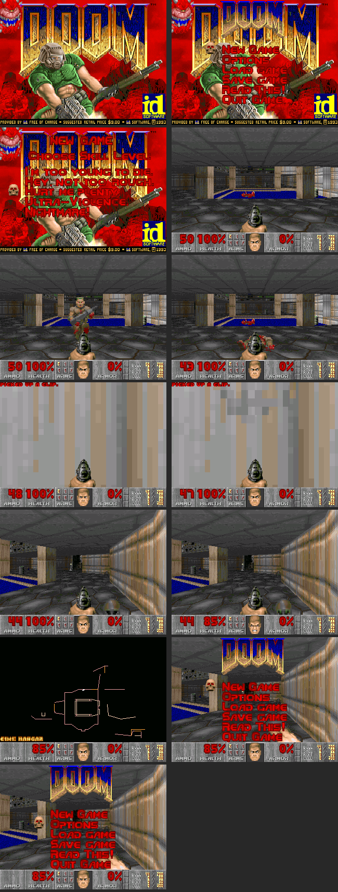

# DOOM on the M5Stack Core2

PrBoom 2.5 (a source port of id Software's Doom engine) with the shareware
episode, running on an M5Stack Core2. The engine comes from
[retro-go](https://github.com/ducalex/retro-go), an emulator firmware for
ESP32 handhelds that ships PrBoom as one of its apps. This project replaces
retro-go's system layer with one for the Core2. It compiles with ESP-IDF
v5.4.4 and plays in Espressif's QEMU emulator (see "Testing in QEMU").
**It has not run on a Core2 yet**, so the M5Unified display, touch, motion
and speaker code is untested and the tilt settings are guesses.

## Layout

| path | contents |
|---|---|
| `components/prboom/` | the engine, copied from retro-go's `prboom-go/components/prboom` at commit `4ced120` |
| `main/doom_main.c` | the platform layer (the `I_*` functions the engine calls): video, sound, music, input, boot |
| `main/m5_hal.cpp` | a C wrapper over M5Stack's M5Unified library for the display, touch panel, IMU, speaker and vibration motor |
| `main/qemu_hal.c` | the same interface for QEMU: a virtual display, discarded audio and a scripted input sequence |
| `tools/qemu_run.py` | builds the QEMU variant, boots it and saves a screenshot at each point the script marks |
| `sdkconfig.qemu` | the settings the QEMU variant layers on `sdkconfig.defaults` |
| `wads/DOOM1.WAD` | the shareware game data file (IWAD), packed into the `wads` flash partition at build time |
| `partitions.csv` | 3 MB app, 12 MB read-only WAD partition, 960 KB wear-levelled save partition |

## Engine changes

The engine differs from retro-go's copy in two places, both marked `m5:`.

- **Analog movement** (`g_game.c`, `g_game.h`). PrBoom's joystick input is
  digital: any deflection turns or moves at full speed. To make tilt
  proportional, `g_game.c` gains two globals, `analog_turn` (in the engine's
  turn units, positive turns left) and `analog_forward` (forward-move units,
  positive moves forward). `doom_main.c` sets them from the accelerometer
  every game tick, and `G_BuildTiccmd` adds them to the turn and forward
  movement of the player's command for that tick.
- **Hit callback** (`p_inter.c`, `i_system.h`). `P_DamageMobj` calls
  `I_HapticHit(damage, killed)` when the local player damages something, so
  the platform layer can buzz the motor on a hit.

## Build and flash

Install ESP-IDF 5.4 by following
[Espressif's getting-started guide](https://docs.espressif.com/projects/esp-idf/en/v5.4.4/esp32/get-started/index.html).
The code was written against v5.4.4. Connect the Core2 over USB-C, then:

```sh
. $IDF_PATH/export.sh
idf.py set-target esp32
idf.py -p /dev/ttyACM0 build flash monitor   # use your serial port
```

`idf.py flash` writes the app and a FAT image of the `wads/` directory. It
does not touch the `saves` partition, so saved games and settings
(`prboom.cfg`) survive reflashing; `idf.py erase-flash` wipes them. On the
device the two partitions are mounted at `/wads` and `/saves`.

Any IWAD up to 12 MB fits. The registered `DOOM.WAD` (11 MB) does and
`DOOM2.WAD` (14.6 MB) does not. To use another IWAD, put it in `wads/` and
change `IWAD` in `main/doom_main.c` to its name.

## Testing in QEMU

Espressif's fork of QEMU emulates the ESP32 with its flash and PSRAM, plus a
virtual display. It does not emulate the Core2's screen controller, touch
panel, IMU or speaker, so the QEMU variant swaps `m5_hal.cpp` for
`qemu_hal.c` and everything else is the hardware code: boot, partitions,
WAD loading, the engine, sound and music mixing, and the input mapping in
`doom_main.c`. Install QEMU once, then run the harness from this directory:

```sh
python $IDF_PATH/tools/idf_tools.py install qemu-xtensa
python tools/qemu_run.py
```

It builds into `build-qemu/`, boots the image and plays a script: open the
menu, start E1M1 on Hurt Me Plenty, spawn a zombieman ahead and shoot it,
tilt to walk, touch to fire, tilt to turn, take 15 points of damage, switch
weapon, open and close the automap, open the menu with a C hold and move
down it. The zombieman and the damage are test injections that only the QEMU
build has; they exist so the hit and hurt vibration patterns run every time.
The vibration motor is logged as `VIB <level>` lines in
`build-qemu/run/serial.log`. At each marked point the firmware freezes and the harness
saves a PNG to `build-qemu/run/`. It exits 0 when the script finishes and
non-zero on a crash or a timeout. The frame rate it prints is the
emulator's, not the Core2's.



## Controls

The Core2's buttons A, B and C are the three circles printed under the
screen. They are zones of the same touch panel that covers the screen.

| | in game | in menus |
|---|---|---|
| tilt (top edge away / toward you) | move forward / back | — |
| tilt (right edge down / left edge down) | turn right / left | — |
| touch the screen | fire, while held | left third: slider left · middle: select · right third: slider right |
| A (left circle) | use / open doors; hold 1.2 s to re-centre tilt | up |
| B (middle circle) | switch weapon (PrBoom's toggle between your two preferred weapons) | select (also answers yes) |
| C (right circle) | automap; hold 0.5 s for the menu | down; hold 0.5 s to go back (also answers no) |

Tilt is measured from the pose the device is in when the game starts, so hold
it the way you mean to play while it boots. Holding A to re-centre also
presses "use" once, which is harmless away from doors. The touch controller
(an FT6336U) tracks two touch points, so firing while pressing a circle should
work; that is untested.

## Design

- **Display.** PrBoom renders at the panel's full 320×240 rather than Doom's
  original 320×200, as retro-go does on its 320×240 handhelds. Frames are
  8-bit palette indices in a buffer in internal RAM. `hal_display_frame`
  converts 20-line bands to RGB565 and alternates two DMA buffers, so one
  band is converted while the previous one goes out over SPI.
- **Memory.** After the framebuffer and DMA buffers are allocated,
  `heap_caps_malloc_extmem_enable(0)` sends every later allocation (the
  engine's zone heap and its cache of WAD data) to the 8 MB PSRAM, as
  retro-go does.
- **Sound.** Each sound effect plays straight from the WAD data on one of
  M5Unified's speaker channels (1 to 7). M5Unified mixes the channels and
  resamples the 11 kHz effects to the speaker's 48 kHz output. The Core2 has
  one speaker, so the engine's stereo separation is ignored; its volume is
  mapped to channel volume.
- **Music.** Doom's music is stored as MUS. The engine converts it to MIDI and
  plays it through its built-in OPL2 synthesizer emulator, which renders
  22,050 Hz audio on core 1 into three rotating buffers queued on speaker
  channel 0. Music defaults to volume 8 of 15 and is not rendered at all at
  0. If the frame rate suffers, try music volume 0 first: rendering runs on
  the other core, but both cores share the bus to PSRAM and flash.
- **Vibration.** The motor plays short patterns from the game thread: a
  35 ms blip when a weapon fires (70 ms and stronger for the shotgun, rocket
  launcher and BFG), a tick 30 ms after the blip when the shot lands (longer
  and stronger on a kill), and a pulse, pause and second pulse when the
  player is hurt, the first pulse lengthening with the damage up to 250 ms.
  Being hurt overrides firing, which overrides a hit. Shots are detected by
  the weapon's muzzle flash starting, hurt by the engine's damage counter,
  hits by `I_HapticHit`. The pattern advances once per game tick, so timings
  round up to the next 28 ms. Fists and the chainsaw have no muzzle flash;
  they buzz only when they connect. The pattern stops when a menu opens.
- **Cores.** The game loop owns core 0. M5Unified's speaker task and the music
  renderer run on core 1. The task watchdog is off because the game loop
  never idles.

## Known gaps

- Tilt axis signs (`TILT_TURN_SIGN`, `TILT_MOVE_SIGN`) and thresholds in
  `doom_main.c` are guesses until someone holds the device.
- No strafe control.
- No SD card support; WADs come from flash only.
- Tilt plus three buttons cannot cover strafing or direct weapon selection.
  The plan is a Bluetooth gamepad through Bluepad32, a library that connects
  console controllers to an ESP32. The open question is whether the ESP32's
  Bluetooth stack, which needs internal RAM, fits beside Doom.
- Flash runs in QIO mode on the Core2. Espressif's QEMU fails direct flash
  reads in QIO mode (the WAD partition will not mount), so `sdkconfig.qemu`
  switches the emulator build to DIO. If the Core2 logs `f_mount failed` for
  `/wads`, set `CONFIG_ESPTOOLPY_FLASHMODE_DIO=y` for the hardware build too.
- PSRAM runs at 80 MHz. If the board boot-loops with PSRAM errors in the
  monitor output, set `CONFIG_SPIRAM_SPEED_40M=y` in `sdkconfig.defaults`
  and delete `sdkconfig` before rebuilding (ESP-IDF reads the defaults only
  when no `sdkconfig` exists), or change it in `idf.py menuconfig`.

## Credits and licenses

This directory is GPL-3.0 (`LICENSE`). `main/doom_main.c` is adapted from
retro-go's `prboom-go/main/main.c`, licensed GPL version 3, and PrBoom's
GPL-2.0-or-later allows the combination under version 3. `main/m5_hal.cpp`
and `main/m5_hal.h` are MIT (the repository's root `LICENSE`), as marked in
their SPDX headers.

PrBoom is by Florian Schulze, Colin Phipps, Neil Stevens, Andrey Budko and
the Boom and MBF authors before them (GPL-2.0-or-later; see
`components/prboom/COPYING` and `AUTHORS`). The ESP32 port lineage runs
through Espressif's `esp32-doom` (Jeroen Domburg) and ducalex's retro-go.
`DOOM1.WAD` is id Software's shareware release, which may be redistributed
unmodified.
